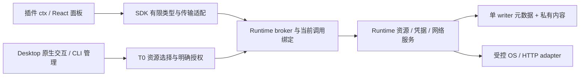

# 插件原生能力：API 设计与实施计划

- 日期：2026-11-05。
- 状态：design-proposal；维护者已要求设计与计划，接口尚未实现、未冻结。
- 范围：文件资源、外部打开、安全凭据、受管 HTTP 与文件传输；先交付 Windows/T1。
- 当前依据：`main` 的 G7 基线 `7fcd9ee`，以及另行评审中的
  [G8 安全 PR #17](https://github.com/FlowToolsOrg/flowtools/pull/17)
  的 `0b99b4c` 实现。PR #17 尚未合并，不能把其保护描述成 main 已具备。
- 本文只交付设计；NA0–NA7 均 pending，不改写 G0–G8、E01–E10 状态。
  正式发行、签名、第三方隔离、独立安全审阅保持各自原有门禁。

## 1. 当前基础与设计取舍

| 能力     | 当前实际实现                                                                                                                       | 本次拟补齐                                                    |
| -------- | ---------------------------------------------------------------------------------------------------------------------------------- | ------------------------------------------------------------- |
| 文件     | SDK `fs` 接受路径，只有文本读与文本/字节写；G7 T0 文件流程已有持柄身份检查、私有计划、逐效果日志、确认和撤销                       | 插件可用的资源句柄、分块读取、有限目录列举、受控新文件导出    |
| 外部打开 | Desktop 使用官方 Opener；G8 分支主窗口仅允许 HTTP(S) URL，SDK 无对应能力                                                           | 按插件、操作和目标授权的 URL 打开、文件打开、文件定位         |
| 凭据     | Runtime 已有 DPAPI 私有任务载荷；没有通用插件凭据服务                                                                              | Runtime 所有的凭据库、原生管理界面、用途受限的凭据引用        |
| 网络     | SDK `request` 是 fetch 签名；旧宿主直接 fetch；broker 已区分 NetworkRead/NetworkSend，但精确 origin 比对没有实施 DNS/redirect 策略 | 无 GUI 依赖的 Rust 出站适配、凭据注入、有限响应读取、上传下载 |

实际来源：[ctx](../packages/sdk/src/types/ctx.ts)、
[SDK capability types](../packages/sdk/src/types/capabilities/index.ts)、
[broker](../packages/runtime-core/src/broker.rs)、
[持久权限](../packages/runtime-core/src/policy.rs)、
[文件流程](../packages/runtime-core/src/file_workflows.rs)、
[文件事务](../packages/runtime-core/src/file_workflows/store/execution.rs)、
[媒体发布](../packages/runtime-core/src/file_workflows/media_io.rs)、
[私有任务载荷](../packages/runtime-core/src/private_jobs.rs)、
[受管 runner](../packages/plugin-runner/src/runner.ts)。

Tauri 的 [FS](https://v2.tauri.app/plugin/file-system/)、
[Opener](https://v2.tauri.app/plugin/opener/)、
[Stronghold](https://v2.tauri.app/plugin/stronghold/)、
[HTTP](https://v2.tauri.app/plugin/http-client/) 与
[Upload](https://v2.tauri.app/plugin/upload/) 用于对照功能与平台适配。
Runtime 独立 CLI 的可用性要求文件、凭据与网络事实由 Rust Runtime 持有；
Desktop 官方插件只作为受控平台适配，不能成为第二套 grant 或任务服务。
Tauri 窗口权限仍不等于逐插件授权。

首批文件功能限定为读取、列举和创建新文件；复制/移动/覆盖/删除、目录 watch
和持久目录授权列为后续扩展。现有 G7 rename/undo 保持原流程，不能把它的
“可撤销改名”推广成任意文件操作事务。新 API 不能调用任意程序或选择 executable。

## 2. 共同调用与权限模型

### 2.1 所有权与入口



插件调用链复用 Host 绑定的 root caller、当前 consumer/provider、package digest、
command、dependency lock、runId、grant epoch、deadline 和预算。插件参数不含
caller、pluginId、namespace、grant、原生路径或授权确认 token；这些均由 T0 绑定。
全部祖先声明/grant 与叶子 scope 取交集；不能借 root 的资源或凭据执行 provider IO。

交互选择和业务操作是两个边界。原生选择器显示实际目标插件/命令与所需权利；
选择文件只产生候选资源，用户明确授权且 broker 检查通过后才可用于业务。
“选择完成”“已有句柄”“能力已注入”均不是 grant。CLI 管理输入路径可以进入
认证 T0 管理面，路径不会进入插件参数，也不能由普通 run flag 自动换取授权。

面板侧交互先经过可信 Host action ticket，绑定 catalog 中的命令、owner 代次和
交互会话；执行开始后接入实际 run。不能把共享主窗口任意 JS 自报的 pluginId
当成认证。当前 T1 同 realm/普通 runner 可绕过 JS SDK，这些接口不构成 T2/T3
隔离；第三方执行仍等待原有 G5/G8 平台门禁。

### 2.2 句柄与生命周期

所有 `*Ref` 是随机、不透明字符串的 SDK 品牌类型；品牌仅防误用，T0 注册表才是
权限依据。Ref 绑定 profile、Runtime 实例/恢复 generation、实际 owner、包身份、
命令/调用、epoch、期限、操作和资源身份；跨 owner、服务 hop 或恢复后的重用拒绝。
不得仅验证 UUID 格式或客户端提供的摘要后放行。

面板资源可以在同一 owner 的显式提交中由 Host 绑定到新 run；普通 JSON 中复制
字符串不产生跨调用或跨插件委托。E07 尚未交付，首批服务默认不接收资源/凭据
转交；未来委托必须重新签发收窄后的子引用。

每次敏感阶段均检查当前权限：读取/发送之前、异步返回后、每个块交付之前、
发布/完成提交之前。取消、deadline、撤销、停用和 provider drain 关闭未完成
句柄与网络流；终态写入与实际 IO 排空后释放持有对象。未知持久化/排空保留
私有状态并停止相关准入，不能以 Promise 已结束当作排空证明。

公开 Ref 默认不跨重启；中断后的私有计划/回执仍按原恢复规则保留，恢复不会
续期 epoch、恢复凭据使用许可或重放网络发送。任何查询恢复只返回已知事实。

### 2.3 Manifest 与 wire 兼容

当前 Manifest v1 的 effects、capability 枚举与 scope 格式是封闭契约，不能向旧
`native`/`storage` 塞入 opener 或 secrets，也不能静默扩展 v1 枚举。
NA0 设计并实现显式 Manifest v2：保持现有包身份/签名/文件清单的归属，新增严格
权限 scope union 与下表操作。旧 v1 解析、字节、摘要、数值语义及原 corpus 保持。
v1 插件继续走原有有限路径，不自动升级或继承新权限；v2 新 API 要求明确 Host/SDK
版本范围，签名包兼容性与 G4 锁/目录准入也必须支持 v2 后才能执行。

| SDK 操作                   | broker 效果/权限设计                                   | scope 与限制                                                                       |
| -------------------------- | ------------------------------------------------------ | ---------------------------------------------------------------------------------- |
| 资源 read/stat/list        | 复用 `file-read`；v2 `fs` 分开声明 read/stat/list      | T0 选择的精确资源槽、Ref 操作权与子条目边界；目录列举不自动授予内容读取            |
| 新文件发布                 | 复用 `file-create`、v2 `fs.create`                     | 精确新文件目标与实际父目录、已批准发布计划；没有覆盖 fallback                      |
| 打开 URL                   | 新增 `opener-open-url` / `opener.open-url`             | 规范化 origin 与严格 path 规则；独立于 network grant                               |
| 打开/定位资源              | 新增 `opener-open-resource` / `opener-reveal-resource` | 当前已批准文件 Ref；读文件不自动允许交给外部应用                                   |
| 使用凭据                   | 新增 `secret-use` / `secrets.use`                      | 当前包、预声明凭据槽、精确端点、方法、注入位置和当前凭据 revision                  |
| HTTP GET/HEAD              | 复用 `network-read` / `network.request`                | 当前精确 HTTPS origin + method，再收窄 path/address/header/response 策略           |
| HTTP POST/PUT/PATCH/DELETE | 复用 `network-send` / `network.request`                | 额外绑定发送正文/文件身份与动作摘要、当前授权；GET 携带敏感 query 也须数据外发授权 |

表中新增效果/权限均待实现；旧 `Scope::FileHandle`/NetworkRead/NetworkSend 的
序列化保持原义。v2 scope 通过版本分派进入新严格类型，旧 PolicyImport、旧
grant 文档不接受新字段；单 writer 迁移必须保留旧记录并默认不给新权限。
交互选取、导出目的地和凭据管理属于 T0 管理操作，与插件业务 grant 分开。

Rust 继续拥有 wire DTO、schema 和正反 fixtures。现有 wire client 精确版本为
`0.3.0`；NA0 为新合同分配新 client/profile 版本，未实现前不在本文虚报版本号。
旧客户端在业务 IO 前明确拒绝。沿用 Rust codegen、LF 属性、漂移拒绝与 G8
静态 validators，不手写 DTO 镜像或改写生成产物来掩盖漂移。私有 runner 帧同样
需要严格版本和 bounded callId；身份始终取自 Host 绑定的 pipe。

## 3. 文件资源 API

### 3.1 拟议 SDK 表面

新增可选 `ctx.resources`；旧 `ctx.fs` 类型保持兼容，不新增路径通配或生产授权。
下列为设计草案，类型拟放入 `@flowtools/sdk/resources`：

```ts
type ResourceRef = string & { readonly __resource: unique symbol }
type OutputTargetRef = string & { readonly __outputTarget: unique symbol }
type ResourceCursor = string & { readonly __resourceCursor: unique symbol }

interface ResourceInfo {
  ref: ResourceRef
  kind: 'file' | 'directory'
  name: string // 仅 basename；不作为 HTML、路径或授权标识解释
  size: number | null
  revision: string // 不透明版本；T0 保存实际 held identity/content pin
}
interface ResourceChunk {
  bytes: Uint8Array
  nextOffset: number
  eof: boolean
}
interface ResourcePage {
  entries: ResourceInfo[]
  nextCursor: ResourceCursor | null
}
interface ResourceOptions {
  signal?: AbortSignal
}

interface ResourceCapability {
  interactive?: ResourceInteraction
  resolve(slot: string): Promise<ResourceInfo>
  stat(ref: ResourceRef, options?: ResourceOptions): Promise<ResourceInfo>
  read(
    ref: ResourceRef,
    options: ResourceOptions & {
      offset: number
      maxBytes: number
      revision: string
    }
  ): Promise<ResourceChunk>
  list(
    ref: ResourceRef,
    options: ResourceOptions & {
      cursor?: ResourceCursor
      limit: number
      revision: string
    }
  ): Promise<ResourcePage>
  createArtifact(
    input: {
      bytes: Uint8Array
      mediaType?: string
    },
    options?: ResourceOptions
  ): Promise<ResourceInfo>
  exportNew(
    source: ResourceRef,
    target: OutputTargetRef,
    options?: ResourceOptions
  ): Promise<ResourceInfo>
  release(ref: ResourceRef | OutputTargetRef): Promise<void>
}
```

`resolve(slot)` 只返回接受此命令时已由 Host 绑定的资源；名称相同不匹配其他调用。
`exportNew` 的 source 必须是本调用已准入的文件或私有结果 artifact，拥有读取
和导出权；target 是 Host 选择并批准的精确新文件，不是目录路径。`release`
幂等关闭本 owner 的引用，不能删除文件、解除其他 lease 或取消 durable 计划。

React 面板另有可选 `ctx.resources.interactive`：

```ts
interface ResourceInteraction {
  selectFiles(options: {
    multiple?: boolean
    extensions?: readonly string[]
  }): Promise<readonly ResourceInfo[] | null>
  selectDirectory(): Promise<ResourceInfo | null>
  selectNewOutput(options: {
    suggestedName: string
  }): Promise<OutputTargetRef | null>
}
```

这些方法只请求可信选择/授权交互，取消返回 null。没有 UI 的 runner 不注入该分支；
需要交互时明确返回 INTERACTION_REQUIRED，CLI 应先完成 T0 管理选择再提交命令。
下载目的地复用 `OutputTargetRef`；`suggestedName` 仅为校验后的 basename。
子文件名不允许作为路径拼接 API；目录条目只获得已批准操作，内容读取须独立授权。

### 3.2 私有内容与发布

首批增加有界 `createArtifact({ bytes, mediaType? }) -> ResourceInfo`，供插件把
处理后的字节存为本调用私有 artifact。仅接受 Uint8Array 和纯 metadata；内容按
64 KiB 帧分块，先预算再分配。它不发布 OS 文件，也不自动产生 file-create grant。
大内容的增量 writer 是后续扩展，首批不能把任意 AsyncIterable 放进 wire JSON。

发布复用 G7 的 held directory、create-only staging、原意图/逐效果 journal
以及受控最终发布原则；从媒体专用路径抽取复用逻辑时保留全部原测试与限额。
父目录身份改变、源 revision 改变、目标存在或撤销时拒绝。跨设备和已有文件覆盖
不降级复制/替换。失败是否留下私有 staging 与发布是否未知必须进入原恢复状态。

首批目录只列一层，不跟随 reparse/junction/symlink，不接受 UNC、ADS、设备路径、
大小写/规范化绕过；保护 Runtime profile、凭据与安装根。稳定 cursor 绑定目录
revision 和 owner，目录变化返回 REVISION_CONFLICT，不能续用旧游标静默漏项。
读操作使用 held file 与固定内容 pin，改变后拒绝，不能只用 mtime 检查。

## 4. 外部打开 API

新增面板侧可选 `ctx.opener`；无桌面交互的 headless/background 调用拒绝：

```ts
interface OpenReceipt {
  status: 'dispatched' // 仅 OS 接受请求，不证明用户看到、读取或完成外部操作
}
interface OpenerCapability {
  openUrl(url: string): Promise<OpenReceipt>
  openResource(ref: ResourceRef): Promise<OpenReceipt>
  revealResource(ref: ResourceRef): Promise<OpenReceipt>
}
```

每次通过一次性 Host action ticket 绑定实际 owner、操作、精确目标摘要、epoch
和短期限，再由已连接 Desktop 的 Rust adapter 执行。确认前后都重新检查；没有
Desktop session 返回 INTERACTION_REQUIRED，不唤起 GUI、不自动冷启动。
Runtime 管理面只可发起同等原生交互，不能借调用者自报的 userGesture 放行。

首批 URL 只允许 HTTPS，无 userinfo、控制字符、非 Web scheme 或本地 file URL；
规范化 origin + path 规则由 v2 声明/grant 共同约束。query/fragment 不入审计；
含凭据引用或已知认证参数的 URL 拒绝，OAuth/自定义协议后续独立设计。
外部浏览器后续跳转不由 Runtime 控制，不声称提供浏览器流量隔离。

文件打开需独立授权，限制为明确允许的文档/媒体类型。拒绝 executable、脚本、
快捷方式和未知关联；不提供指定 application、argv、cwd、env。文件关联可能
执行外部程序，因此 default-deny，平台对照不足时只交付 reveal。Opener 的
路径 API 无 held-handle 原子打开保证；NA3 必须明确“交给 OS 的路径仍存在竞态”
这一限制，不能用前置 stat 把它标成已解决的 TOCTOU。未证明安全的 resource-open
分支继续拒绝，必要时仅允许 T0 私有、固定格式导出副本并给出独立证据。

Desktop 仅从 Runtime 已批准操作取得内部目标，不把通用 openPath/reveal 权限
授予插件 WebView。沿用官方 Opener 的 Rust adapter，并保持 G8 AppManifest 的
逐命令清单与 pre-handler 拒绝；不恢复插件/core default 权限集合。

## 5. 安全凭据 API

新增可选 `ctx.secrets`；插件只访问声明的逻辑槽位，原始内容留在 Runtime：

```ts
type CredentialRef = string & { readonly __credential: unique symbol }
interface SecretSlotInfo {
  configured: boolean
  revision: number | null
}
interface SecretCapability {
  describe(slot: string): Promise<SecretSlotInfo>
  getRef(slot: string): Promise<CredentialRef>
  interactive?: {
    manage(slot: string): Promise<'saved' | 'removed' | 'cancelled'>
  }
}
```

`manage` 打开可信原生保存/替换/删除界面，输入不经插件 React state 或 runner。
CLI 用原生隐藏输入或明确的 stdin 输入，禁止 argv/env、shell 历史与诊断回显。
插件不提供 `get()`/`set(value)`，`getRef` 也不保证已授权使用。首批仅支持 bearer
或固定 allowlist header 注入；没有任意 query、URL、cookie、代理或跨 provider 使用。

slot 来自 v2 包声明，credential 存储 owner 为 package publisher + pluginId +
profile；版本/hash 变化可保留私有密文，但使用绑定必须显式重审，不能继承 grant。
持久管理记录只保存逻辑 ID、revision、状态和约束的非敏感引用；短期 CredentialRef
还绑定具体调用、current package、精确端点/路径/方法、注入位置与 secret revision。
修改/删除凭据即使原 command grant 未变，也立即使旧 Ref 与排队使用失效。

Windows 首个实现选择 Runtime 内的独立 DPAPI secret store，复用现有受保护
profile/ACL 与单 writer 的管理元数据。`PrivateJobs` 不是凭据库，不能把长期密钥
伪装成 job input/output；加密 envelope、revision、create-only journal、读回与
恢复规则需新模块。SQL 与密文文件之间使用 prepared/committed 状态，未知写入
保留旧/新密文并停止相关使用，不能凭文件存在宣称替换成功。

Stronghold 是后续可评估的跨平台实现；当前 CLI-only Runtime 不依赖 Tauri，
不把 WebView 的 Stronghold store 或 vault password 交给插件，也不在本次文档中
预先安装新依赖。后端接口必须使所有平台共用相同 owner/revision/授权语义。

凭据库首批不加入通用备份导出；profile 恢复使所有 CredentialRef 与 use 绑定
失效，保留可解密旧密文但需重新确认。删除失效 Ref 和逻辑删除不声称 SSD 上
安全擦除。原始 key 不进入 SDK 返回、任务参数/结果、日志、URL、数据库 metadata
或审计。用户已授权的远端可能回显认证 header，因此响应视为敏感私有内容，
不能保证数据交给目标服务后仍不可回传；该残余风险必须在授权说明中呈现。

## 6. 受管请求与文件传输 API

### 6.1 兼容入口与有限类型

保留 `ctx.request(input, init)` 的现有 fetch 签名；把原 type alias 演进为有调用
签名的结构类型，增加可选 `managed` 属性。旧普通函数仍满足该类型，新插件
必须检测 `ctx.request?.managed`；SDK 不把类型断言当成 Host 支持证据。

拟议受管分支如下，类型放入 `@flowtools/sdk/network`。这是一份独立有限 DTO，
不会把 Request/Response、AbortSignal、回调函数、FormData 或 stream 对象发进 JSON。

```ts
type ResponseRef = string & { readonly __response: unique symbol }
type EndpointSlot = string
interface NetworkOptions {
  signal?: AbortSignal
  onProgress?: (value: {
    sentBytes: number
    receivedBytes: number
    totalBytes: number | null
  }) => void
}
interface ManagedHttpRequest {
  endpoint: EndpointSlot // 在声明的 HTTPS origin/path 下由 T0 解析
  method: 'GET' | 'HEAD' | 'POST' | 'PUT' | 'PATCH' | 'DELETE'
  pathSegments: readonly string[]
  query?: readonly (readonly [string, string])[]
  headers?: Readonly<Record<string, string>>
  body?:
    | { kind: 'text'; value: string }
    | { kind: 'resource'; ref: ResourceRef }
  credential?: CredentialRef
}
interface ManagedHttpResponse {
  ref: ResponseRef
  status: number
  headers: Readonly<Record<string, string>>
  contentLength: number | null
}
interface TransferResult {
  status: number
  sentBytes: number
  receivedBytes: number
  output: ResourceInfo | null // 下载成功发布的新文件；上传响应也按私有资源处理
}
interface ManagedNetworkCapability {
  send(
    request: ManagedHttpRequest,
    options?: NetworkOptions
  ): Promise<ManagedHttpResponse>
  readBody(
    ref: ResponseRef,
    options: {
      maxBytes: number
      signal?: AbortSignal
    }
  ): Promise<{ bytes: Uint8Array; eof: boolean }>
  closeBody(ref: ResponseRef): Promise<void>
  upload(
    request: ManagedHttpRequest & {
      method: 'POST' | 'PUT'
      body: { kind: 'resource'; ref: ResourceRef }
    },
    options?: NetworkOptions
  ): Promise<TransferResult>
  download(
    request: ManagedHttpRequest & { method: 'GET' },
    target: OutputTargetRef,
    options?: NetworkOptions
  ): Promise<TransferResult>
}
```

`pathSegments` 每项作为单一段编码；拒绝绝对 URL、分隔符/点段、重复编码绕过。
slot 必须由当前包声明并绑定其端点策略，不能解析成任意 catalog/service selector。
GET/HEAD 禁止 body，下载同样禁止 body；跨字段规则由 Rust 和 SDK fixtures 同验。
返回 header 是允许列表，不返回 Set-Cookie、认证/代理内部信息或完整敏感 URL。
`readBody` 单消费者顺序读取，同一 response 的累计字节与调用预算不可重置。
`closeBody` 幂等取消和释放；未消费 body 也受闲置期限/总期限约束。

现有 callable 的受管实现仅桥接有限 fetch 子集：字符串/URL、固定方法、可序列化
header、小文本/字节正文、AbortSignal 与有限 Response。拒绝任意 Request、
自定义 stream、cookie credentials、代理和不支持的 RequestInit；不静默忽略。
采用有限 Response adapter 消费同一 response handle，text/json/arrayBuffer/流
共享预算。旧 WebView fetch 只保留原 T1 兼容范围，不宣称已受新出站策略隔离。

### 6.2 出站、凭据与授权

Rust Runtime 的 HTTP 实现复用官方 HTTP 插件对应的 Rust 客户端技术路径，具体
依赖/feature、许可证、锁文件与扫描在 NA5 确定；不要求 Desktop 存活。不能以
Tauri http URL scope 或现有 broker 精确 origin 比对代替真实 DNS/连接策略。

首批默认 HTTPS、系统证书验证、无全局 cookie jar、无继承 Host 认证/环境代理、
无任意客户端证书或 TLS 忽略开关。每次解析检查所有 A/AAAA 地址，拒绝 loopback、
private、link-local、multicast、unspecified、保留范围及 IPv4-mapped 绕过。
检查通过的地址必须绑定实际连接，TLS SNI/证书校验仍使用原 host；重解析、连接
池复用和 resolver fallback 也不能绕过地址策略。证据不足时保持 adapter 拒绝。

首批 `redirect = error`，含 30x 的响应不会自动跟随或转发凭据；后续逐跳支持需
重新检查 origin、address、method、body 与 credential。响应正文按压缩和解压后
两层限额，Content-Length 缺失不代表无限；header/解码错误拒绝，TLS 失败不降级。
headers 拒绝 CR/LF、Host/Connection/Content-Length、Authorization、Cookie、
Proxy-\* 等受控字段；认证 header 仅从已绑定 CredentialRef 注入。

每次外发必须有当前网络授权。NetworkRead 的 GET/HEAD 不表示“不外发数据”；
endpoint 声明的 query/path/header 参数区分公开常量与用户内容，发送文件、用户
文本、敏感 query 或使用凭据还须绑定明确的数据外发批准。POST/PUT/PATCH/DELETE
继续使用 NetworkSend，批准摘要绑定实际 method/URL/body digest/credential
revision；参数变更、队列过期、凭据轮换、服务 scope 缩窄都使旧批准失效。

只有经包校验且被当前 grant 锁定的精确常量模板可以作为“公开常量”；插件运行时
自行标注 public 不生效。所有动态 path/query/header/body 参数都视作潜在用户
内容并纳入批准摘要，不提供通过 GET 或自报敏感等级绕过外发确认的通道。

首批阻止直接本地网段访问；局域网设备、自签证书、HTTP 和企业代理是以后单独
授权/测试的 profile，不能用“兼容所有 fetch”静默开放。

### 6.3 传输与任务完成

上传先验证源 held identity/revision/内容摘要，读取权与网络发送权同时成立；
首批仅 raw-body POST/PUT，不伪装 multipart/form-data。下载复用 OutputTargetRef
和资源发布流程，HTTP 成功且正文完整、字节/可选批准摘要一致、IO 排空与当前授权
成立后才 create-only 发布。失败不留“成功”的最终文件，不自动覆盖冲突目标。

send/upload/download 属于当前接受任务内的受管调用，使用同一 runId、祖先预算、
deadline 和 jobs.metadata writer。进度为当前任务的有限子事件，callback 只在
本地 SDK 执行；不增加独立传输任务库或任意跨任务查询。完成百分比不构成成功。
上传收到 HTTP 非 2xx、下载正文截断、校验失败和发布未知均不能报 succeeded。
普通 send 则像 fetch 一样返回 HTTP status，由插件处理业务错误。

网络已发出的字节不能撤回。发送前先持久化 bounded intent，结果未知或崩溃后
保留 Interrupted/待核实状态；不自动重试 send/upload，不把内部幂等 key 当远端
幂等保证。下载首批也不自动 resume/Range，重试需新明确动作并核对现有 staging。
SDK 自己调用两次是两个被计费/授权的操作，不能由 SDK 自动包装成无限重试。

## 7. 初始预算、错误与恢复

以下为首批设计上限，NA0 以边界 fixtures 固定；不增加 G7/G6 已有数值上限。
实际有效值取包声明、当前 grant、祖先剩余量、deadline 与 Host 硬上限的最小值。

| 项目                 | 拟议首批上限                                                                           |
| -------------------- | -------------------------------------------------------------------------------------- |
| wire 帧              | 保持现有 1 MiB；binary 用 base64 DTO，单原始块最多 64 KiB，计入编码后实际帧长          |
| 文件/私有新 artifact | 单文件最多 64 MiB；首批 createArtifact 内存入口最多 1 MiB                              |
| 目录                 | 最多观察 512 条、准入 128 个文件；每页最多 64 条，仅一层                               |
| 私有内容池           | 单 profile 总计最多 256 MiB，并与现有文件工作流合并计费；不得每 API 各获一份额度       |
| 活跃资源             | 每 run 最多 32 个 Ref；每 profile 最多 128；held handle、page cursor、response 均计费  |
| 凭据                 | 每 owner 最多 16 槽；单值最多 16 KiB；profile 最多 256 槽/4 MiB 明文等价预算           |
| HTTP                 | 每 run 最多 4 个在途、64 次调用；每 profile 最多 16 个在途；全部受父调用剩余预算约束   |
| HTTP 内容            | 文本 body 最多 1 MiB、header 总计 32 KiB；单传输/响应最多 64 MiB，任务累计最多 256 MiB |
| 期限                 | HTTP 最多 30 秒或任务剩余期限；body 空闲最多 5 秒；opener ticket 最多 30 秒且单次      |

首批 64 MiB 是能力上限，不是所有 recipe/媒体输入的新上限；G6 1 MiB 媒体输入、
既有输出/进程/排空配额继续原值。资源池协调应将用户文件观察、私有 staging、
网络响应与下载统一登记，不能修改安装工具的独立物理池计数来借出容量。

优先复用现有错误：CAPABILITY_UNDECLARED、APPROVAL_REQUIRED、INTERACTION_REQUIRED、
SCOPE_DENIED、GRANT_REVOKED、REVISION_CONFLICT、BUDGET_EXCEEDED、TIMEOUT、ABORTED、
RECOVERY_PENDING、ACCEPTANCE_UNKNOWN、STORAGE_FAILED。另拟增加稳定的
CAPABILITY_UNAVAILABLE、RESOURCE_EXPIRED、NETWORK_FAILED；由 NA0 纳入 Rust enum、
schema、静态校验与 TS 映射，不能在现有 wire 中先发送未知 code。
未知/跨 owner Ref 都返回统一 SCOPE_DENIED，不通过不同错误暴露资源是否存在。
不可用分支不回退 raw fetch、路径 FS、通用 invoke 或静默内存凭据库。

审计只写 operation、Host 生成的调用/owner digest、状态码、字节计数、时间和
拒绝码；普通 history、诊断与 PR 证据不含 basename、完整 URL/query、header、
body、secret、私有 Ref 或异常原文。内容只在获准插件的私有响应/资源中存在。

## 8. 分阶段实施计划

NA 是本文局部工作包编号，不是新的发布阶段或既有 milestone 完成声明。
每项先独立验证与提交，后续依赖通过才开放入口；本次只完成这份文档。

| 工作包 / 依赖                        | 交付与主要修改面（新模块均为拟新增）                                                                                                        | 必须通过的退出标准                                                                                                                                                 |
| ------------------------------------ | ------------------------------------------------------------------------------------------------------------------------------------------- | ------------------------------------------------------------------------------------------------------------------------------------------------------------------ |
| NA0 契约与兼容 / G8 安全基线先集成   | SDK Manifest v2、包/目录/G4 兼容分派；Rust v2 scope/operation、policy migration、错误、预算、runner framing/cancel；runtime-client 生成契约 | v1 原 corpus/摘要/拒绝完全保留；v2 未知字段/效果拒绝；老 client 握手拒绝；signed package/锁匹配；静态 validator/字节漂移门禁通过；管理与插件角色不能混淆           |
| NA1 资源选择与读取 / NA0             | `runtime-core/src/resources/`、`apps/runtime/src/resources.rs`、SDK resources、Desktop 原生选择、CLI 管理绑定                               | 同一资源可由 GUI/CLI 绑定命令；跨 owner/epoch/恢复 Ref 拒绝；真实 NTFS reparse/替换/变更、分页变化、限额/取消/拒绝无内容泄漏通过                                   |
| NA2 私有 artifact 与新文件导出 / NA1 | 从现有 file_workflows/media 发布抽取复用原语，接入原 single writer/私有内容，增加 exportNew                                                 | 真文件新建、目标冲突、父目录替换、磁盘/SQL 错误、撤销、未知发布/重启拒绝；原 rename/undo 和媒体发布拒绝测试全部保留；无覆盖 fallback                               |
| NA3 外部打开 / NA1、NA2              | Runtime opener 授权与 ticket，Desktop 官方 Opener Rust adapter，SDK panel 入口                                                              | 原生固定无害目标正对照；伪 ticket/重放/过期/未知 scheme/远程窗口/headless 拒绝；没有 raw opener IPC 授权；openResource 竞态未解决时只开放已验证 reveal/URL 分支    |
| NA4 凭据库 / NA0；交互复用 NA1       | `runtime-core/src/secrets/`、Runtime DPAPI backend、原生密码管理/CLI stdin、单 writer 管理日志                                              | 保存/替换/删除/revision 竞争、重启/恢复/撤销、跨 namespace/provider、损坏/未知提交/ACL 拒绝；canary 不进 runner/日志/metadata/历史；旧 Ref 轮换后拒绝              |
| NA5 受管 HTTP / NA1、NA4             | `runtime-core/src/network/`、`apps/runtime/src/network.rs`、SDK request.managed、Rust HTTP 客户端与 resolver/连接绑定、finite fetch adapter | 实际 TLS/HTTP adapter 的正反 fixture；A/AAAA/rebinding/pool/代理/redirect/压缩/超量/凭据端点限制/发送批准/取消均验证；缺失 adapter 明确拒绝；无全局 fetch fallback |
| NA6 上传下载 / NA2、NA5              | 受管资源流与同任务进度/intent、上传 raw body、下载 create-only 发布、GUI/CLI 统一观察                                                       | 真实文件上传/下载/校验/取消/撤销与当前 task 排空；服务收到发送后本地 ACK 丢失不重发；截断/non-2xx/磁盘失败不发布；同一 runId 两端观察一致                          |
| NA7 开发者交付 / NA1–NA6             | 固定轻量内置样例、API 支持矩阵、权限 UI、CLI describe/文档、SDK hooks/错误说明                                                              | 文件处理→导出→定位，与配置凭据→受管 API→下载两条实际链；清楚显示支持/声明/授权分别状态；全根门禁与同 SHA Windows CI 通过，按原要求记录 UI/人工项目与独立审阅状态   |

NA0 必须先完成整个契约/包链，不以“先临时放宽 v1”缩短路径。runner 当前串行
exchange 只适合小 JSON 请求；资源流实现需 bounded 响应句柄、背压、独立取消/
关闭路径，逐帧关联 callId，不能把大响应一次塞入 1 MiB 帧或在等待网络时阻塞
整个 Runtime 管理循环。数据 plane 与控制 plane 的角色仍由现有会话绑定。

新平台 adapter 优先使用官方 Tauri 插件；需要新增 Desktop 插件时依仓库流程
通过 `bun run tauri add <plugin-name>` 安装，再逐项配置本地命令权限。Runtime
独立服务依赖通过 Cargo 正式管理，所有变化同步锁文件并跑实时安全扫描。

新模块归属：`packages/sdk` 放插件契约/本地包装；`packages/runtime-core` 放
身份、scope、actor、恢复与存储；`apps/runtime` 放无 GUI 的 OS/HTTP adapter；
Desktop 只放可信交互与 OS opener；`runtime-client` 只消费公开生成导出；CLI
只做同一管理/执行流程的入口。`packages/ui` 只在 NA7 需要复用控件时修改。
Host-only API 不由普通 SDK 主入口导出，Web 原型对原生分支明确 unsupported，
受控 mock 仅用于测试，不在产品以 localStorage 模拟安全凭据。

## 9. 验证矩阵与安全评审

| 风险            | 新接口必须提供的证据                                                                                           | 沿用边界                                                             |
| --------------- | -------------------------------------------------------------------------------------------------------------- | -------------------------------------------------------------------- |
| SEC-003/007     | 直接绕过 SDK 的实际 native IPC/runner 帧拒绝；未知字段/深层重复 JSON key、伪 owner、grant 缺失、epoch 变化     | G8 AppManifest、本地 main、pre-handler guard；管理 role 不可执行插件 |
| SEC-004         | 真实 NTFS 句柄、reparse/ADS/UNC/设备名、父目录替换、内容竞争、create-only 与恢复 journal                       | 原 file_workflows 和媒体发布测试、原配额、私有内容保留               |
| SEC-005         | 真实连接对应已检查 IP、IPv6/mapped/private/rebinding、redirect/代理/TLS、header 注入、凭据 revision 与外发内容 | CSP 不构成逐插件网络隔离；T1 同 realm/runner 仍可绕过 JS 接口        |
| SEC-006/008/013 | 单 writer 迁移/精确前驱/trigger/readback、备份恢复后 grant/ref 失效、CLI-only 无 GUI                           | 不恢复旧授权/信任 floors，不复制另一份业务 DB                        |
| SEC-009/010     | secret/path/URL/body canary、超量/压缩/空闲流、取消/期限、慢消费者与真实排空                                   | 元数据-only history、共享父预算、未知状态不删字节                    |
| SEC-012         | URL/文件关联类型策略、ticket 单次/来源、禁止 background opener、只承诺 OS dispatched                           | 不宣称外部浏览器跳转受控；不开放任意程序路径                         |
| SEC-014/015     | provider 参数不能继承 root 凭据/资源；原工具/服务锁、grants、任务持有与 drain 回归                             | 不新增工具 selector、argv、执行 grant 或 third-party profile         |

网络 fixture 使用受控证书/测试 resolver 与实际本地测试 server；只有 cfg(test)
可注入固定地址，产品不出现 localhost allow switch。原“私网必须拒绝”的生产
路径负对照与可工作测试路径正对照都要执行，不能用 mock 校验函数代替实际连接。
原生正对照使用固定无害文件/目标，不访问真实用户凭据或公网账户。

每个实现提交按修改面运行 SDK/Core/client/Runtime/Desktop/CLI 相关测试、lint、
类型与构建；生成契约变更跑 `generate:hosts`、`verify:runtime-contracts` 和原
漂移检查；修改命令包同步实际 manifests 与 command docs。最终根 `test` 与
`build` 按顺序执行，再完成生产入口拒绝、安全扫描和 clean-worktree 门禁。
不放宽既有测试 deadline、不跳过原 native 用例、不用缓存结果掩盖缺产物。

本次纯文档交付运行 docs:check、现有 docs-check 测试、Markdown 格式与 diff
检查，并额外检查本文本地链接；不把文档通过当成任何新 API 的运行证据。
NA0–NA7 的实现测试、Native/UI 验收和独立安全 Reviewer/date/conclusion 均 pending。
既有 G7 manual waived 只适用其原验收范围，不自动覆盖这里的新用户流程。

## 10. 关联决策与后续范围

- [信任边界 ADR](./adr/0001-plugin-trust-boundaries.md)：身份来源、T0/T1 与第三方隔离。
- [能力与包策略 ADR](./adr/0002-capability-and-package-policy.md)：声明/grant/scope、服务交集、外发与恢复。
- [受控信任恢复 ADR](./adr/0004-controlled-trust-recovery.md)：恢复不会重新授予旧权限。
- [下一阶段计划](./next-milestones.md)、[生产路线图](./production-roadmap.md)：原 G0–G8 顺序及发布边界。
- [E 宿主扩展](./host-extensions.md)：E07 资源交接、E08 事件、E10 兼容信息保持各自范围。
- [威胁模型](./security/threat-model.md)：风险 ID 保留 open，按实现与独立审阅另记证据。

本轮未选择的后续项：持久目录授权/自动 watch、任意文件修改、局域网/HTTP/
代理 profile、multipart、断点续传与自动重试、OAuth/深链登录、非 bearer 的
签名算法、跨插件 secret 委托、完整 DLP、其他平台与正式第三方执行。每项需
独立窄接口与验收，不通过扩展通用 native.invoke 或 shell 提供快捷通道。
