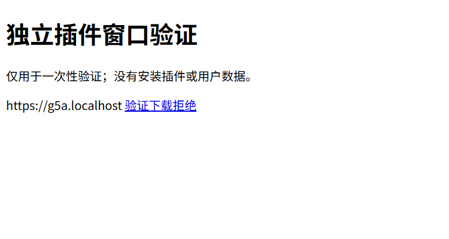

# G5 P2.1 Windows WebView feasibility

- Date: 2026-10-31
- Scope: prototype, Windows/x64, dedicated disposable Debug harness
- Status: targeted prototype checks passed; P2.1/G5 pending
- Engineering review: Codex; independent security reviewer/date/conclusion pending
- Threats: SEC-001, SEC-002, SEC-008, SEC-014, SEC-015

This harness tests native WebView2 boundaries separately from product activation.
It never calls `desktop_lib::run`, opens the user's Runtime database, installs a
plugin, creates a grant or adds a production execution endpoint. The ordinary
Web/Desktop/CLI third-party refusal remains in force.

## Entry and identity

`apps/desktop/src-tauri/src/bin/validate-plugin-webviews.rs` requires the
nondefault `plugin-webview-validation` feature. Its embedded configuration is
`tauri.plugin-webview-validation.conf.json`, with identifier
`com.flowtools.g5-plugin-webviews-validation-20261012`. A fresh direct child of
Temp owns four independent WebView data directories and four download directories.
The windows are hidden by default and never request focus. There are no official
Tauri plugins or production custom handlers in this binary.

The generated Tauri context initially includes production ACLs even when the
macro receives `capabilities = []`. The harness proves the original main-window
event permission as a positive control, explicitly replaces RuntimeAuthority,
then checks that main and all validation labels have no core ACL access. Merely
changing the visible configuration does not clear the generated authority.

The Node harness connects only to loopback CDP listeners whose actual owning
process belongs to this native child tree and whose browser command line binds
the expected disposable data directory. CDP arguments are child-only; global
WebView profile/browser overrides are refused. It uses the project's pinned
Playwright client, with the actual installed WebView2 runtime rather than a
substitute browser.

## Tested contracts

Four native environments use `g5host.localhost`, `g5a.localhost`,
`g5b.localhost` and a second `g5a.localhost` environment. The same-origin second
environment distinguishes profile partitioning from origin separation. Checks
cover localStorage, cookies, IndexedDB and Cache API. A reload preserves its own
storage while revoking the old message generation.

The only plugin operation is an inert echo over a 2 KiB strict envelope. Native
context, label, current top-level URL and browser Origin must agree with a bound
session. OS-generated session/nonce values, generation, sequence and a per-session
budget reject replay, another WebView, forged source/session/nonce, old generation,
unknown operations and unknown fields. A separate host-only read-only snapshot
returns bounded counters. Payload identity never selects a native caller.

Reload invalidates the old native session. This single-use profile does not
publish a replacement authenticated session to the reloaded document.

Fixture responses enforce self-only script CSP without inline/eval permission;
fixed same-origin and cross-origin frame navigations are tested as denied.
Each WebView starts at `about:blank`. Its private native
download folder is set and read back, and an all-resource/all-source native
request filter is installed before the fixed fixture navigation. Navigation,
popup and download handlers refuse effects. Tests exercise both ordinary CSP
denial and an independent native request probe while CDP temporarily bypasses
CSP before a controlled reload, restoring it with another reload in `finally`.
Both CSP initialization timing and the independent native counter increment are
checked; rejection by CSP alone is not native-filter evidence. The public
test-only TLS fixture is never installed in a certificate store or trusted by
the WebViews. Only the Host's exact owned-loopback positive control accepts it.
Ordinary CSP probes require no TCP connections. Under the controlled CSP bypass,
the native layer must increment its refusal counter with zero completed TLS
handshakes and HTTP requests. TCP connections are recorded separately, and all
four native download directories must stay empty.

Actual native invoke checks cover production command names, the management
command, filesystem and event APIs, and the host-only snapshot. Refusal must
occur in native handling/ACLs, not only in a hidden button or missing JS helper.

## Failure history and cleanup

Earlier iterations exposed three real gaps: generated ACLs survived configuration
replacement; a public script nonce permitted an unintended source; and a denied
navigation still sent an HTTP request. Their failing observations led to explicit
RuntimeAuthority replacement, external self-only fixture scripts and a native
all-source request filter. A later CDP startup failure remains a failed run, not
passing evidence. No port retry, substitute browser or relaxed startup budget
turns that failure into acceptance.

The independent native probe initially still hit CSP because bypass was enabled
after document initialization. Reloading the owned fixture after the toggle and
again after restoration fixes that test layering; the behavior is documented by
[the browser API](https://pptr.dev/api/puppeteer.page.setbypasscsp).
The corrected probe then proved native refusal, but its stronger exploratory
zero-TCP assertion failed: three speculative TCP connections reached the live
canary, with zero completed TLS handshakes/HTTP requests. That failed observation
is retained separately. The declared prototype checks distinguish ordinary CSP
denial from native HTTP refusal and record TCP connections as an open platform
gap. They do not certify network isolation or close G5.

The original visible validation windows interrupted the maintainer's desktop.
The default is now hidden. Normal and deliberate native termination paths must
await all observed native descendants, close the canary independently, and retain
logs and fixture provenance even after assertion/cleanup failure. Disposable
profiles are retained for inspection; they are never silently adopted as user
data. A recorded `running` or `checks-passed-cleanup-pending` file is not a pass.

The root process must carry the exact fresh-profile instance argument, verified
by both native startup and the controller before CDP attachment or custody.
A reused PID belonging to another run of the same binary cannot qualify merely
because its image path matches. Process custody binds both PID and microsecond
creation time. Parent edges older
than a reused parent PID are excluded. Termination pins a Process handle and
compares its actual birth before killing it; exit checks compare birth identities,
so a new unrelated application reusing an old PID is neither killed nor reported
as a surviving validation child. Cleanup stages independently attempt scan,
disconnect, root termination, orphan termination and drain; any unresolved stage
prevents a pass even while later cleanup continues.

## Reproduction and evidence

From the repository root, after dependency setup:

```powershell
bun run --cwd apps/desktop test:plugin-webview
```

This builds the opt-in native binary and runs the normal, post-CDP interruption
and pre-snapshot startup-interruption harnesses sequentially. The original runs
completed on 2026-10-13; all three passed again on 2026-10-31 after binding the
root instance, with hidden windows and verified process drain. Before each run,
the real native image receives a mismatched instance argument: it must exit with
exact status 101 and the expected refusal, before creating any profile entries.
The normal terminal record is `passed`; both interrupted records are
`interruption-cleanup-passed`. Local machine logs, counters and screenshots are
written below ignored `execution-validation/g5-webviews*`.

The final normal run recorded four native profiles, two accepted echoes, ten
envelope rejections, three custom-invoke denials, three revoked generations,
one navigation denial, one popup denial, two download callbacks denied and three
native external-request denials. The source cookie/IDB/cache/storage positive
controls passed. After the Host positive control, the independent CSP-bypass
canary received three TCP connections, zero completed TLS handshakes and zero
HTTP requests, retaining the declared network limitation above. No owned native
child remained after the three runs. Rust feature clippy, source lint/types and
contract tests were run separately; full workspace/remote acceptance is recorded
with the integration delivery rather than inferred from these targeted checks.

On 2026-10-31, the resumed nine-test contract run had eight passes and a timeout
in the actual process-handle test under pinned Bun 1.3.14. An existing CI contract's
Cargo metadata launch also timed out. The same PowerShell helper completed in
about 0.6 seconds under Node; a minimal Bun direct-spawn probe reproduced the
timeout, while its cmd launcher control completed. This resembles
[an upstream Windows spawn report](https://github.com/oven-sh/bun/issues/32011),
but does not establish the exact cause here. Original deadlines and assertions
remain intact. Local full acceptance and current-revision Windows CI remain
pending; the earlier native harness results do not replace those gates.

The clean, strict-environment workflow subsequently passed on integrated commit
`a7dede2`, including all 101 Desktop contract tests and the original nine WebView
cases. The instance-binding follow-up also passed Desktop's standard task under
strict Turbo, feature clippy, source lint/types and all three actual native runs.
These passes do not erase the separately retained inherited-environment failures
or establish their exact cause. Final-head remote checks are reported separately.

The actual hidden-WebView screenshot was visually inspected for fixture identity,
origin and Chinese text; it is not manual product/accessibility approval:



## Remaining gates

This is a standalone native feasibility profile. Product Tauri configuration
still needs its own CSP/capability/custom-command integration; this harness does
not change that configuration or certify it. Its identity binding checks the
top-level native WebView, not the actual invoking frame URL. The tested fixed
frame URLs are refused; about:blank, srcdoc and inherited-frame authentication
are not certified. Future frame support needs an independent authenticated binding.
Caller-supplied IPC headers cannot replace native authentication.

Native request filtering does not prevent all speculative network connections;
the observed TCP gap requires a separate platform control and acceptance before
production third-party network isolation can be claimed.

Signed installed identities, the real broker, trusted consent/revocation,
data lifecycle, malicious production artifacts, release/manual acceptance and
independent security approval remain pending. No maturity advances and no T2/TL
production activation follows from these checks.
